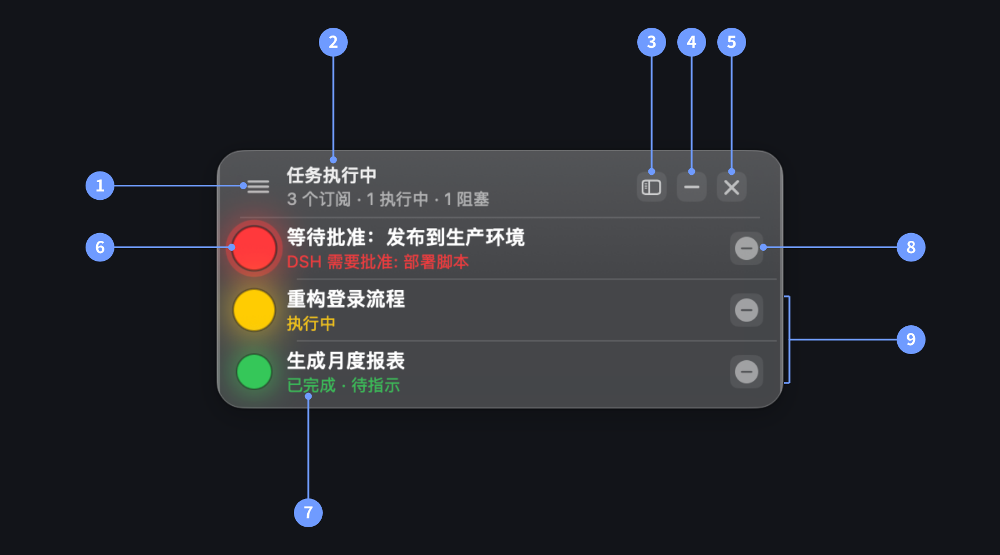
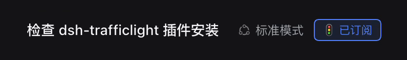
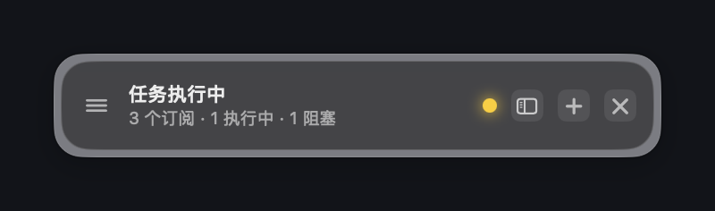
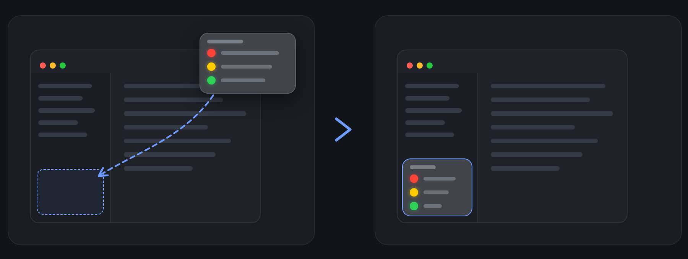
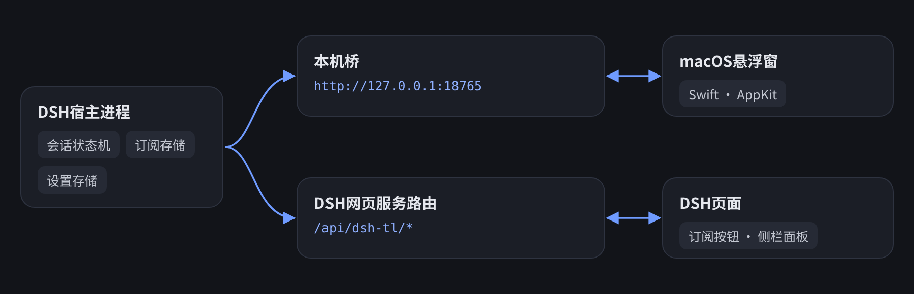

# dsh-trafficlight

> 插件市场名称：**任务状态灯**

DSH任务状态红绿灯：订阅会话后，每个会话用一盏灯显示进度，等你批准时亮红灯，执行中亮黄灯，完成后亮绿灯。灯可以浮在所有窗口最上层，也可以收进DSH侧栏。



1. **拖动柄**：按住拖动窗口，松手后位置会被记住。
2. **订阅摘要**：整体状态，以及订阅数、执行中和阻塞的数量。
3. **归位**：把面板收进DSH侧栏，见[归位到侧栏](#归位到侧栏)。
4. **折叠**：收成一条标题栏，再点一次展开，见[折叠](#折叠)。
5. **关闭**：取消全部订阅并退出悬浮窗。只想暂时藏起来，用菜单栏🚦里的「隐藏悬浮窗」。
6. **状态灯**：颜色含义见[灯态](#灯态)。
7. **会话标题和状态**：阻塞时显示原因；点这一行会切到DSH并打开该会话。
8. **取消订阅**：只移除这一个会话。
9. **缩放边缘**：左右两侧都能拖动调整宽度，悬停时边缘会亮起并出现↔提示。宽度会被记住。

菜单栏里还有一个🚦图标，可以查看整体状态、显示或隐藏悬浮窗、退出红绿灯。

## 安装

```bash
dsh plugin --profile desktop add https://github.com/erinwangstudio-art/dsh-trafficlight.git
```

如果当前DSH版本不支持从Git安装，先克隆仓库，再用本地路径安装：

```bash
dsh plugin --profile desktop add /path/to/dsh-trafficlight
```

装好后重启DSH Desktop。用命令行`dsh web`的，把`--profile desktop`换成对应的profile。

仓库已附带构建好的`lib/`和悬浮窗二进制（arm64、macOS 13+），安装后不需要编译。其他架构见[从源码构建](#从源码构建)。

## 订阅会话

打开任意会话，点顶部的「🚦订阅」。订阅成功后按钮变成「已订阅」，悬浮窗会自动出现：



- 再点一次「已订阅」即取消；
- 订阅列表会保存下来，DSH重启后自动恢复，悬浮窗也会自动拉起；
- 在悬浮窗或侧栏里取消订阅，按钮状态会在2秒内同步过来。

## 灯态

| 灯 | 状态 | 什么时候亮 | 动效 |
|---|---|---|---|
| 🔴 | `blocked` | 等待你批准，或在向你提问（`ask_user_question`） | 快速呼吸，外圈扩散光环 |
| 🟡 | `running` | 回合正在执行 | 持续慢呼吸 |
| 🟢 | `done` | 回合已结束 | 常亮 |
| ⚪ | `idle`/`offline` | 已订阅但还没开始 / 和DSH断开 | 常亮 |

另外，每次状态变化时，灯会额外放大回落几次作为提醒，次数和速度可以在[设置](#设置)里调。

## 折叠



折叠后只剩标题栏：订阅摘要还在，右侧小灯显示整体状态，原来的折叠按钮变成「+」。

## 归位到侧栏



把悬浮窗拖进DSH侧栏底部的虚线区，松手即可固定。拖到虚线区上方时面板会变成全磨砂，表示现在松手就会固定。也可以直接点标题栏的归位按钮（第一张图中的3）。

归位后：

- 点一行跳到对应会话，行末✕取消订阅；
- 点面板上的「悬浮窗」切回浮动；
- 侧栏面板如果没有正常显示出来（例如DSH页面没加载），12秒后会自动退回浮动；DSH重启后的等待时间是15秒。这样灯不会凭空消失。

## 极简模式

在设置里打开后，悬浮窗只保留拖动柄、关闭按钮和一盏大灯。大灯显示最近一次发生变化的那个会话的状态。

## 设置

在DSH的插件设置里找到「🚦红绿灯悬浮窗」，改动实时生效，页面内有预览。

| 设置项 | 范围（默认） | 作用 |
|---|---|---|
| 悬浮窗透明度 | 0.1–1（1） | 越低越通透，越高越磨砂 |
| 极简模式 | 开/关（关） | 见[极简模式](#极简模式) |
| 呼吸次数 | 1–6次（3次） | 状态变化时灯放大回落的次数 |
| 呼吸速度 | 0.1–1秒（0.35秒） | 每次放大或回落的时长 |

## 工作原理



插件在DSH宿主里监听`session/event`，把每个会话归成四种灯态；订阅列表和标题保存在`~/.dsh/storages/dsh-trafficlight.json`。同一份状态通过两个入口提供，只对本机开放：

| 入口 | 使用方 | 接口 |
|---|---|---|
| `127.0.0.1:18765`（可用环境变量`DSH_TL_PORT`修改） | 悬浮窗每0.7秒拉一次`/state` | `/state`、`/stream`（SSE）、`/subscriptions`、`/focus`、`/mode`、`/opacity`、`/minimal`、`/breath` |
| DSH网页服务下的`/api/dsh-tl/*` | 订阅按钮每2秒同步一次；侧栏面板每秒刷新并上报心跳 | 同上，另有`/dockbeat`（侧栏心跳）和`/events`（SSE） |

端口被占用时，本机桥不会启动，只保留网页路由，悬浮窗会显示未连接。

## 从源码构建

宿主和网页部分：

```bash
npm install
```

```bash
npm run build
```

上游声明的开发依赖`@deepseek-ai/dsh-client-runtime@^0.1.5-rc.1`目前在npm上取不到，`npm install`可能失败。这时可以直接使用仓库里已构建好的`lib/`，或参考[FORK-NOTES.md](./FORK-NOTES.md)用本地DSH运行时构建。

悬浮窗（macOS 13+）：

```bash
bash overlay/build.sh
```

`build.sh`默认加`--disable-sandbox`；没有指定SDK且本机装有`MacOSX15.4.sdk`时会默认用它，以绕开本机SDK和编译器版本不匹配的问题。也可以手动指定SDK：

```bash
DSH_TL_OVERLAY_SDKROOT=/Library/Developer/CommandLineTools/SDKs/MacOSX26.2.sdk bash overlay/build.sh
```

把新编译的悬浮窗换进已安装的插件并重启：

```bash
P="$HOME/.dsh/profiles/desktop/node_modules/@erinwangstudio-art/dsh-trafficlight"
```

```bash
cp overlay/.build/release/TrafficLightOverlay "$P/overlay/.build/release/"
```

```bash
codesign --force --sign - "$P/overlay/.build/release/TrafficLightOverlay"
```

```bash
bash "$P/scripts/trafficlight.sh" --restart
```

### 不启动DSH预览悬浮窗

```bash
node mock-bridge.mjs
```

```bash
bash scripts/trafficlight.sh
```

`mock-bridge.mjs`会模拟几个会话，在执行中、阻塞、完成之间循环切换。`trafficlight.sh`在Swift源码比二进制新时会自动重新编译，日志写在`~/.dsh/trafficlight-overlay.log`，加`--restart`可强制重启。

## 兼容性

| 插件版本 | 适用的DSH | 说明 |
|---|---|---|
| **0.4.0-fork.1**（当前） | DSH Desktop `0.2.2-rc.3`、dsh web `0.1.5-rc.1` | 需要`dsh-client-locale`和`dsh-client-ui-conversation`提供的插槽 |
| 0.3.x | dsh `0.1.x` web profile | 没有归位和Liquid Glass |

## 已知限制

- 只支持macOS，悬浮窗基于AppKit/SwiftUI。
- 仓库里的悬浮窗二进制是arm64、macOS 13构建，其他架构需要自行编译。
- 订阅按钮只能放在会话顶部：DSH侧栏里会话的「…」菜单是写死的，插件无法往里加选项。
- 悬浮窗是不抢焦点的窗口，macOS不允许它改变鼠标指针，所以缩放边缘用绘制的高亮和↔提示代替。
- 原生Liquid Glass需要macOS 26+，更早的系统自动退回普通毛玻璃；设置`DSH_TL_FORCE_VIBRANCY=1`可以强制使用后者。

## 目录结构

```
dsh-trafficlight/
├── src/
│   ├── index.ts                  # 插件入口：状态流、本机桥、网页路由
│   ├── core/types.ts             # 前后端共享的数据类型
│   ├── host/
│   │   ├── status.ts             # 状态机：session/event → 四种灯态、摘要、标题
│   │   ├── subscriptions.ts      # 订阅列表及持久化
│   │   ├── overlay-launcher.ts   # 有订阅时自动拉起悬浮窗
│   │   ├── settings.ts           # 透明度、极简模式、呼吸参数、呈现模式
│   │   └── bridge.ts             # 本机桥（18765）和/api/dsh-tl/*
│   └── client/index.tsx          # 订阅按钮、侧栏面板、设置页
├── lib/                          # 构建产物（随仓库提交）
├── overlay/                      # macOS悬浮窗（Swift）
│   ├── TrafficLightApp.swift     # 窗口位置、拖动、缩放、折叠、归位
│   ├── TrafficLightWindow.swift  # 置顶透明面板、Liquid Glass
│   ├── TrafficLightView.swift    # 灯列表、折叠条、极简模式
│   ├── StatusClient.swift        # 轮询本机桥
│   └── build.sh
├── images/                       # README配图
├── docs/LOCAL-PATCHES.md         # 补丁与排查记录
├── mock-bridge.mjs               # 不启动DSH时的模拟数据源
└── scripts/trafficlight.sh       # 一键启动悬浮窗
```

## 许可证

[MIT](./LICENSE)
